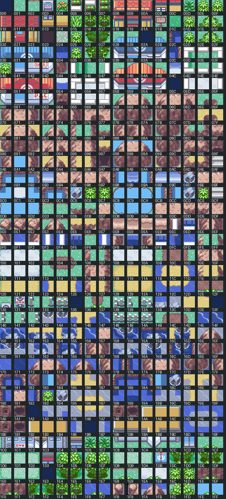

# Hoenn tilesets for FireRed Remastered

Added **Hoenn General**, **Hoenn Interior**, and **74 secondary sets** representing 64 Emerald tilesets. Oversized sets are divided into numbered parts. All are registered and selectable in Porymap.

## Choosing a pair in Porymap

After pulling `follower-port`, reopen Porymap. Use the layout tileset selectors:

| Use | Primary | Secondary examples |
| --- | --- | --- |
| Towns, beaches and nature | `gTileset_HoennGeneral` | `gTileset_HoennDewford`, `gTileset_HoennRustboro`, `gTileset_HoennFortree`, `gTileset_HoennPacifidlog` |
| Cave scenery | `gTileset_HoennGeneral` | `gTileset_HoennCavePart1`, `gTileset_HoennMeteorFalls`, `gTileset_HoennRusturfTunnel` |
| Interiors | `gTileset_HoennInterior` | `gTileset_HoennGenericBuildingPart1`, `gTileset_HoennPokemonCenter`, `gTileset_HoennShop` |

Try the sets on a new or copied layout. Changing a tileset reinterprets existing metatile numbers, so a FireRed/Orange map needs repainting to use Hoenn art. Hoenn General is intended to pair with these new Hoenn secondary sets. See the full catalog for the source-supported primary choices. Some sets were used with both primaries in Emerald.

Existing maps retain their tilesets. Original General, Sevii, Orange, and the earlier HoennBuilding/HoennDesert/HoennVolcano ports are preserved. The earlier ports keep their existing pairing requirements.

## Preview catalog

Click a preview to view all available metatiles and their FireRed IDs. These images use static animation frames.



| Porymap tileset | Primary choices | Graphics / limit | Metatiles / limit | Preview |
| --- | --- | --- | --- | --- |
| `gTileset_HoennGeneral` | Primary set | 640/640 | 640/640 | [View](previews/HoennGeneral.png) |
| `gTileset_HoennInterior` | Primary set | 640/640 | 640/640 | [View](previews/HoennInterior.png) |
| `gTileset_HoennBattleArena` | HoennInterior | 116/384 | 160/384 | [View](previews/HoennBattleArena.png) |
| `gTileset_HoennBattleDome` | HoennInterior | 214/384 | 323/384 | [View](previews/HoennBattleDome.png) |
| `gTileset_HoennBattleFactory` | HoennInterior | 180/384 | 312/384 | [View](previews/HoennBattleFactory.png) |
| `gTileset_HoennBattleFrontier` | HoennGeneral, HoennInterior | 154/384 | 367/384 | [View](previews/HoennBattleFrontier.png) |
| `gTileset_HoennBattleFrontierOutsideEastPart1` | HoennGeneral | 228/384 | 384/384 | [View](previews/HoennBattleFrontierOutsideEastPart1.png) |
| `gTileset_HoennBattleFrontierOutsideEastPart2` | HoennGeneral | 25/384 | 60/384 | [View](previews/HoennBattleFrontierOutsideEastPart2.png) |
| `gTileset_HoennBattleFrontierOutsideWest` | HoennGeneral | 285/384 | 368/384 | [View](previews/HoennBattleFrontierOutsideWest.png) |
| `gTileset_HoennBattleFrontierRankingHall` | HoennInterior | 86/384 | 68/384 | [View](previews/HoennBattleFrontierRankingHall.png) |
| `gTileset_HoennBattlePalace` | HoennGeneral, HoennInterior | 81/384 | 146/384 | [View](previews/HoennBattlePalace.png) |
| `gTileset_HoennBattlePike` | HoennInterior | 107/384 | 195/384 | [View](previews/HoennBattlePike.png) |
| `gTileset_HoennBattlePyramid` | HoennInterior | 132/384 | 138/384 | [View](previews/HoennBattlePyramid.png) |
| `gTileset_HoennBattleTent` | HoennGeneral, HoennInterior | 87/384 | 152/384 | [View](previews/HoennBattleTent.png) |
| `gTileset_HoennBikeShop` | HoennGeneral | 217/384 | 224/384 | [View](previews/HoennBikeShop.png) |
| `gTileset_HoennBrendansMaysHouse` | HoennInterior | 210/384 | 165/384 | [View](previews/HoennBrendansMaysHouse.png) |
| `gTileset_HoennCableClub` | HoennInterior | 182/384 | 246/384 | [View](previews/HoennCableClub.png) |
| `gTileset_HoennCavePart1` | HoennGeneral | 288/384 | 384/384 | [View](previews/HoennCavePart1.png) |
| `gTileset_HoennCavePart2` | HoennGeneral | 61/384 | 23/384 | [View](previews/HoennCavePart2.png) |
| `gTileset_HoennContest` | HoennGeneral, HoennInterior | 111/384 | 188/384 | [View](previews/HoennContest.png) |
| `gTileset_HoennDewford` | HoennGeneral | 172/384 | 306/384 | [View](previews/HoennDewford.png) |
| `gTileset_HoennDewfordGym` | HoennInterior | 43/384 | 63/384 | [View](previews/HoennDewfordGym.png) |
| `gTileset_HoennEliteFour` | HoennInterior | 183/384 | 326/384 | [View](previews/HoennEliteFour.png) |
| `gTileset_HoennEverGrande` | HoennGeneral | 143/384 | 153/384 | [View](previews/HoennEverGrande.png) |
| `gTileset_HoennFacilityPart1` | HoennGeneral, HoennInterior | 335/384 | 384/384 | [View](previews/HoennFacilityPart1.png) |
| `gTileset_HoennFacilityPart2` | HoennGeneral, HoennInterior | 171/384 | 109/384 | [View](previews/HoennFacilityPart2.png) |
| `gTileset_HoennFallarbor` | HoennGeneral | 234/384 | 346/384 | [View](previews/HoennFallarbor.png) |
| `gTileset_HoennFortree` | HoennGeneral | 173/384 | 259/384 | [View](previews/HoennFortree.png) |
| `gTileset_HoennFortreeGym` | HoennInterior | 59/384 | 62/384 | [View](previews/HoennFortreeGym.png) |
| `gTileset_HoennGenericBuildingPart1` | HoennInterior | 350/384 | 384/384 | [View](previews/HoennGenericBuildingPart1.png) |
| `gTileset_HoennGenericBuildingPart2` | HoennInterior | 162/384 | 127/384 | [View](previews/HoennGenericBuildingPart2.png) |
| `gTileset_HoennInsideOfTruck` | HoennGeneral | 40/384 | 28/384 | [View](previews/HoennInsideOfTruck.png) |
| `gTileset_HoennInsideShip` | HoennGeneral | 151/384 | 236/384 | [View](previews/HoennInsideShip.png) |
| `gTileset_HoennIslandHarbor` | HoennGeneral | 49/384 | 53/384 | [View](previews/HoennIslandHarbor.png) |
| `gTileset_HoennLab` | HoennInterior | 181/384 | 148/384 | [View](previews/HoennLab.png) |
| `gTileset_HoennLavaridgePart1` | HoennGeneral | 199/384 | 384/384 | [View](previews/HoennLavaridgePart1.png) |
| `gTileset_HoennLavaridgePart2` | HoennGeneral | 37/384 | 18/384 | [View](previews/HoennLavaridgePart2.png) |
| `gTileset_HoennLavaridgeGym` | HoennInterior | 45/384 | 57/384 | [View](previews/HoennLavaridgeGym.png) |
| `gTileset_HoennLilycove` | HoennGeneral | 236/384 | 324/384 | [View](previews/HoennLilycove.png) |
| `gTileset_HoennLilycoveMuseum` | HoennInterior | 234/384 | 138/384 | [View](previews/HoennLilycoveMuseum.png) |
| `gTileset_HoennMauvillePart1` | HoennGeneral | 233/384 | 384/384 | [View](previews/HoennMauvillePart1.png) |
| `gTileset_HoennMauvillePart2` | HoennGeneral | 263/384 | 120/384 | [View](previews/HoennMauvillePart2.png) |
| `gTileset_HoennMauvilleGameCorner` | HoennInterior | 104/384 | 65/384 | [View](previews/HoennMauvilleGameCorner.png) |
| `gTileset_HoennMauvilleGym` | HoennInterior | 81/384 | 70/384 | [View](previews/HoennMauvilleGym.png) |
| `gTileset_HoennMeteorFalls` | HoennGeneral | 234/384 | 143/384 | [View](previews/HoennMeteorFalls.png) |
| `gTileset_HoennMirageTowerPart1` | HoennGeneral | 277/384 | 384/384 | [View](previews/HoennMirageTowerPart1.png) |
| `gTileset_HoennMirageTowerPart2` | HoennGeneral | 43/384 | 20/384 | [View](previews/HoennMirageTowerPart2.png) |
| `gTileset_HoennMossdeep` | HoennGeneral | 213/384 | 277/384 | [View](previews/HoennMossdeep.png) |
| `gTileset_HoennMossdeepGameCorner` | HoennInterior | 64/384 | 51/384 | [View](previews/HoennMossdeepGameCorner.png) |
| `gTileset_HoennMossdeepGym` | HoennInterior | 61/384 | 63/384 | [View](previews/HoennMossdeepGym.png) |
| `gTileset_HoennMysteryEventsHouse` | HoennInterior | 67/384 | 54/384 | [View](previews/HoennMysteryEventsHouse.png) |
| `gTileset_HoennNavelRockPart1` | HoennGeneral | 284/384 | 384/384 | [View](previews/HoennNavelRockPart1.png) |
| `gTileset_HoennNavelRockPart2` | HoennGeneral | 12/384 | 2/384 | [View](previews/HoennNavelRockPart2.png) |
| `gTileset_HoennOceanicMuseum` | HoennInterior | 180/384 | 104/384 | [View](previews/HoennOceanicMuseum.png) |
| `gTileset_HoennPacifidlog` | HoennGeneral | 258/384 | 186/384 | [View](previews/HoennPacifidlog.png) |
| `gTileset_HoennPetalburg` | HoennGeneral | 122/384 | 131/384 | [View](previews/HoennPetalburg.png) |
| `gTileset_HoennPetalburgGym` | HoennInterior | 113/384 | 103/384 | [View](previews/HoennPetalburgGym.png) |
| `gTileset_HoennPokemonCenter` | HoennInterior | 255/384 | 188/384 | [View](previews/HoennPokemonCenter.png) |
| `gTileset_HoennPokemonDayCare` | HoennInterior | 88/384 | 61/384 | [View](previews/HoennPokemonDayCare.png) |
| `gTileset_HoennPokemonFanClub` | HoennInterior | 89/384 | 74/384 | [View](previews/HoennPokemonFanClub.png) |
| `gTileset_HoennPokemonSchool` | HoennInterior | 64/384 | 36/384 | [View](previews/HoennPokemonSchool.png) |
| `gTileset_HoennPrettyPetalFlowerShop` | HoennInterior | 94/384 | 52/384 | [View](previews/HoennPrettyPetalFlowerShop.png) |
| `gTileset_HoennRustboro` | HoennGeneral | 267/384 | 324/384 | [View](previews/HoennRustboro.png) |
| `gTileset_HoennRustboroGym` | HoennInterior | 48/384 | 55/384 | [View](previews/HoennRustboroGym.png) |
| `gTileset_HoennRusturfTunnel` | HoennGeneral | 79/384 | 67/384 | [View](previews/HoennRusturfTunnel.png) |
| `gTileset_HoennSeashoreHouse` | HoennInterior | 66/384 | 48/384 | [View](previews/HoennSeashoreHouse.png) |
| `gTileset_HoennShop` | HoennInterior | 269/384 | 276/384 | [View](previews/HoennShop.png) |
| `gTileset_HoennSlateportPart1` | HoennGeneral | 383/384 | 353/384 | [View](previews/HoennSlateportPart1.png) |
| `gTileset_HoennSlateportPart2` | HoennGeneral | 50/384 | 22/384 | [View](previews/HoennSlateportPart2.png) |
| `gTileset_HoennSootopolis` | HoennGeneral | 212/384 | 224/384 | [View](previews/HoennSootopolis.png) |
| `gTileset_HoennSootopolisGym` | HoennInterior | 176/384 | 93/384 | [View](previews/HoennSootopolisGym.png) |
| `gTileset_HoennTrainerHillPart1` | HoennInterior | 231/384 | 384/384 | [View](previews/HoennTrainerHillPart1.png) |
| `gTileset_HoennTrainerHillPart2` | HoennInterior | 65/384 | 53/384 | [View](previews/HoennTrainerHillPart2.png) |
| `gTileset_HoennTrickHousePuzzle` | HoennInterior | 192/384 | 168/384 | [View](previews/HoennTrickHousePuzzle.png) |
| `gTileset_HoennUnderwater` | HoennGeneral | 137/384 | 178/384 | [View](previews/HoennUnderwater.png) |
| `gTileset_HoennUnionRoom` | HoennInterior | 48/384 | 37/384 | [View](previews/HoennUnionRoom.png) |

## What the conversion supports

Artwork and colors are preserved. FireRed uses 640 primary and 384 secondary graphics/metatiles; Emerald uses 512 and 512. Primary definitions keep their original IDs and gain blank padding. Secondary graphics are packed with flip-aware deduplication, and duplicate metatiles are collapsed. Metatile definitions that exceed either secondary budget are split across parts. Animated graphics keep distinct, contiguous slots so static art cannot be overwritten by an animation.

Private palettes are assigned only to FireRed background slots 7–12. Behavior IDs are translated by meaning, and Emerald layer flags are converted to FireRed's 32-bit attributes. Grass/water encounter and terrain flags are supplied. Water, waterfalls, shorelines, lava, flags, flowers, TV screens, Gym lights and the other imported tile animation callbacks use the packed destinations. Dome floor lights animate within their allocated palette bank using FireRed's fade state.

Hoenn-specific gameplay systems are **not imported**: Acro Bike rails/slopes, Secret Base customization, ash collection, berry growth, over/under bridges and native Gym/facility puzzle scripts need separate implementation. Their unsupported tile behavior codes receive documented FireRed fallbacks; collision, elevation, warps and events still need configuring when drawing a map. Animated doors may need matching entries in FireRed's door graphics table. Standard doorway/warp behavior conversion is included. Dynamic Secret Base tilesets and Emerald's unused sets are omitted from this static library.

Every source secondary metatile ID is recorded, including duplicate IDs and IDs assigned to another part. The per-set `import.json` files and [import report](import-report.json) contain graphics, palette and metatile mappings. Existing Emerald map binaries cannot simply be copied into FireRed: their IDs and events need conversion. This change adds tilesets, with no map reassignment.

## Verification and regeneration

The ROM build passes. `validate_tilesets.py` checks all 76 sets against the pinned Emerald source: graphics indices, palettes, layers, loaded palette ranges, primary/secondary budgets, complete source metatile coverage, animation bank layout and all 129 imported graphic frames. `--rom` verifies the imported definitions are in the built ROM. Existing Orange exterior and OrangeGeneral validation also pass. Emulator playtesting is still required after creating maps that use these sets.

Source: [pret/pokeemerald](https://github.com/pret/pokeemerald/tree/731ad5bfd6e6f265508d0efcca0ba42f9dcf5881), commit `731ad5bfd6e6f265508d0efcca0ba42f9dcf5881`. Artwork and source animation logic originate from Pokémon Emerald via that decompilation project.

To regenerate from a checkout at that commit (Python 3 and Pillow required), run from this repository:

```sh
python3 docs/hoenn-tilesets/import_tilesets.py --source /path/to/pokeemerald
python3 docs/hoenn-tilesets/register_tilesets.py --source /path/to/pokeemerald
python3 docs/hoenn-tilesets/validate_tilesets.py --source /path/to/pokeemerald
python3 docs/hoenn-tilesets/render_catalog.py
```

The importer refuses to overwrite edited graphics, metatile definitions, attributes or palettes. Review Porymap changes before regenerating. Build using the configured FireRed toolchain, then run validation with `--rom`.
