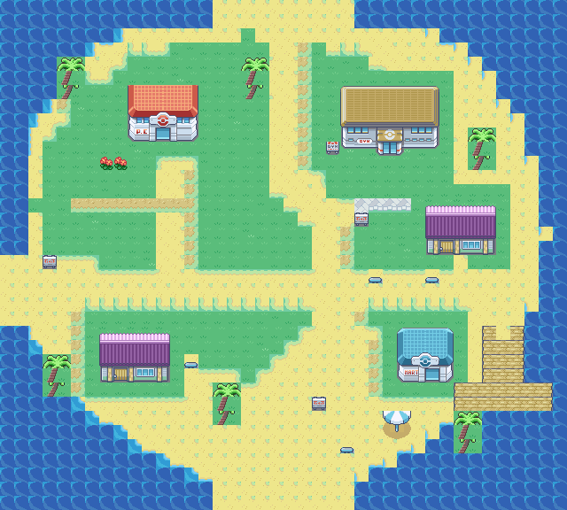
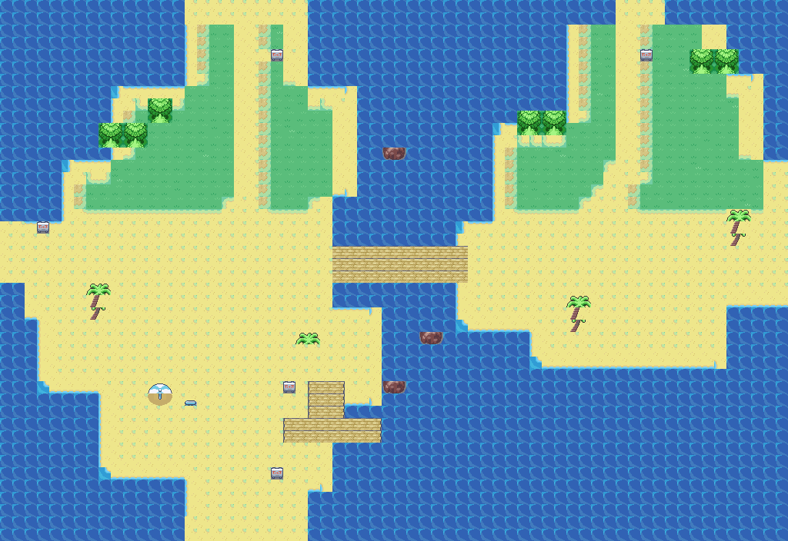
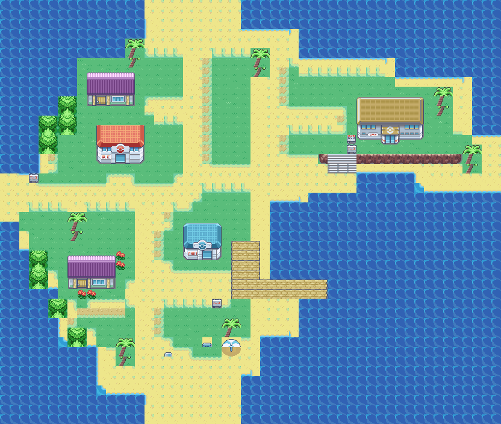

# Orange Islands exterior maps

The Orange Islands group contains **36 exteriors**: 11 towns, 11 coasts and 14 regional routes. Open `gMapGroup_OrangeIslands` in Porymap.

**[Current Navel draft: large island, southern village, summit climb and separate north-beach loop](navel/README.md)**

**[Current sea routes: varied tilesets, cardinal/diagonal crossings and puzzle previews](water-routes/README.md)**

Routes 4–14 now use six pairings across the sea-route group, including Hoenn Mossdeep, Dewford and Pacifidlog. Wider diagonal seas, cliff shelves, karst reefs, current courses and a switchback maze replace the repeated corridor layout. Rock barriers now seal unused sea-map edges; Route 3 retains its two beach joins. The user's Valencia edits and all tileset assets are unchanged. Navel now has two reciprocal trail warps through its separate north beach; external map connections are retained.

See the linked gallery for entrance/exit anchors, matching-tileset requirements when adding future connections, and validation commands. Emulator testing remains necessary. The older whole-region validator needs updating for the user's newer town tilesets and landmarks.

[Earlier town/coast gallery and Sevii references](SEVII_GALLERY.md). That gallery predates the user's latest Porymap edits. The sections below record previous design passes; current map files are the source of truth.

## Design history

The following sections describe earlier passes; their sizes and connection descriptions are historical. Use the gallery above and `data/layouts/layouts.json` for the current layouts.

### Earlier exterior design passes

Based on follower-port commit 2dc0f227cf31c01bce563d674b7fa31f7bb21e8c and the supplied region plan. Open the repository in Porymap and select gMapGroup_OrangeIslands.

| Map | Size | Design |
| --- | --- | --- |
| Valencia | 40×40 | Forest-backed village, north-shore lab, east beach |
| Route 1 | 30×40 | Southern ferry beach, picnic furniture, long pier |
| Route 2 | 50×40 | Winding jungle trail, encounter clearings, pond, optional branches |
| Route 3 | 40×60 | Surf crossing, staggered reef banks, three optional rest islets |
| Mikan | 24×48 | Inland forest town, offset homes, raised Gym forecourt |
| Mikan Beach | 64×44 | Separate coast route, harbor, channel bridge and sea landings |
| Sunburst | 44×36 | Twin north coves, craft terraces and workshop yard |
| Route 4 | 70×30 | Long crossing with staggered sandbars and rest stops |
| Route 6 | 50×36 | Central exploration island, rocky outcrop, two optional islets |
| Navel | 50×60 | Tapered mountain spine, irregular cliff terraces and summit Gym |
| Moro | 36×30 | Forest spit and eastern wreck cove |
| Kinnow | 36×30 | Long northern settlement and southern showboat quay |
| Route 5 | 36×50 | Northward currents with a calm-water bypass |
| Route 7 | 36×60 | Foggy passage, separated reef banks and rest beaches |
| Route 8 | 60×30 | Boulder shelves and a central rest island |
| Mandarin South | 60×50 | Urban districts wrapping an inlet and waterfront quarters |
| Trovita | 44×40 | Hooked bay town and eastern Gym bluff |
| Kumquat | 48×40 | Resort ribbon around a west cove and ferry pier |
| Pinkan | 40×40 | Two wooded lobes, wetland and loop trail |
| Pummelo | 40×40 | Stadium peninsula and narrow boat approach |
| Route 9 | 40×50 | Fishing platforms |
| Route 10 | 60×36 | Wreck debris and rest islands |
| Route 11 | 40×50 | Ring reef with open navigation gaps |
| Route 12 | 70×30 | Broad shipping lane and piers |
| Route 13 | 40×56 | Reserve side channel to Pinkan |
| Route 14 | 60×36 | Outer reef and final island crossing |

Valencia connects south to Route 1 (offset +5), west to Route 2 (offset 0), and north to Route 3 (offset 0); each route has a reciprocal connection. Terrain and collision use the existing General + Orange Islands tilesets. Signs provide local directions. Roofs, palms, shrubs, signs and reef rocks block movement; paths and the pier are walkable. Route 3 requires Surf.

These are editable exterior designs, not a finished region. Building entrances remain blocked until interiors and warps are added. The pier has no ferry event yet. Trainers, encounters, item rewards, and the Surf acquisition sequence remain to be implemented. Route 3 now connects to Mikan. Mikan connects west to Route 6, which connects south to Sunburst. Sunburst connects east to Route 4; Route 4 returns to Route 1 on Valencia. Route 4 departs from the ferry beach instead of sharing Valencia town's west edge with Route 2, avoiding overlapping map connections. Mikan now connects north through Route 5 to Navel; Navel connects east through Route 8 to Kinnow. Sunburst has a separate northwest landing to Route 7 and Moro. Its two north connections occupy disjoint coordinate ranges. Routes 9–14 now connect Navel and Moro to Mandarin South, Kinnow to Trovita, Mandarin South to Trovita and Kumquat, and Trovita to Kumquat. Pinkan connects to Route 13's western side channel. Pummelo is intentionally disconnected from the Surf network until the League ferry event is implemented. The Crystal Onix cave, ghost-ship interior/artwork, showboat vessel/interior, and summit Gym interior are not implemented. Wreck timbers and a berth reserve those sites without suggesting a finished vessel. Regional map sections retain the existing placeholder; map-name popups are disabled on these twenty-five maps to avoid showing LITTLEROOT TOWN.

Route 5 uses native northward current metatiles with clear calm-water endpoints and a western bypass. Moro and Route 7 use horizontal fog. Navel uses cliff collision barriers and stair openings; terraces currently share the standard outdoor elevation, and emulator testing remains necessary.

The layout header was regenerated by the repository build to include the ten previously missing layout IDs already present in layouts.json.

Validation: `python3 docs/orange-islands/validate_maps.py` checks map-buffer limits, binary sizes, metatile IDs, reachable landmarks/signs, current termination, and reciprocal connection seams. `source /workspace/.setup-cache/activate.sh && make -j5 -W data/maps.s` builds the ROM in the prepared cloud environment. The `-W data/maps.s` flag forces the map-data object to rebuild: this repository can otherwise miss changes made only to map.bin. After building, run `python3 docs/orange-islands/validate_maps.py --rom` to confirm the ROM embeds every designed layout exactly. Emulator traversal and visual review in Porymap remain necessary; the reachability check does not emulate Surf mounting, followers or event execution.

All 25 existing Orange Islands layouts now have exterior designs. This is a region-wide first pass, not a fully playable expansion. Pinkan currently uses existing tropical plants; pink palette variants are still needed. Route 11 is a visual ring reef with open gaps, not a new Whirlpool mechanic. Pummelo's arena is an outdoor footprint; its battle and ferry events are pending. Valencia now follows the supplied forest-backed village reference in arrangement and uses a proper lab facade; it is an interpretation of the screenshot, not a pixel-exact reconstruction.

PNG previews accompany the source maps. They render the actual existing tiles/metatiles with static animation frames.

## Terrain and building polish pass

Reviewed all 25 layouts. Replaced 1,832 abrupt sand/grass edge tiles with native transition and corner tiles where appropriate. Added sparse native grass texture, mixed red/blue residential roofs, and upper floors on selected homes (12 residential facades reviewed). Corrected paved street/forecourt centers and grassy curb edges. Existing buildings, stairs, encounter clearings, major paths and connected border corridors retain their roles; connection-edge tiles remain unchanged. Sea routes without grassy land did not need sand/grass changes. No new graphics, palettes, ferry scripts or interiors were added.

Valencia has now been reshaped around the supplied reference, with the lab on the north shore, a western forest edge and an eastern beach.

## Remaining work

- Review and refine the new island layouts in Porymap, including Valencia's interpretation of the reference image.
- Extend the tropical tileset for distinctive lab/Gym buildings, a ghost-ship wreck, showboat, resort/stadium details, and Pinkan palette variants.
- Create building, Gym, cave and ship interiors with reciprocal door/stair warps. Current building doors are blocked exterior placeholders.
- Add ferry arrival/return and the Kumquat–Pummelo League boat. Pummelo is not connected to the Surf network.
- Populate routes and towns with NPCs, trainers, items, encounters and quest events, including the Surf acquisition sequence and Gym progression.
- Add proper Orange Islands region-map names and locations; placeholder names currently have popups disabled.
- Test the region in an emulator, including Surf entry/exit, currents, stairs, followers, connections, weather, interiors and story progression. Static reachability checks do not replace gameplay tests.

## Orange General tileset and color pass

The 25 Orange layouts now use `gTileset_OrangeGeneral` (`data/tilesets/primary/orange_general`). Kanto and Johto retain the original General. This copy keeps every General metatile ID and attribute, deduplicates static graphics with flip-aware remapping, and reserves separate animation banks with a dedicated callback. The tropical secondary metatiles were remapped to match. Do not pair this remapped Orange Islands secondary with the original General.

The primary bank still has 640 slots: 587 are occupied and 53 trailing slots (587–639) are blank and available for future imports. The 640/384 split and GBA hardware limit are unchanged. This conservative packing retains the complete General editing vocabulary; pruning unused structures could free more space later. Sevii building imports are not part of this pass.

Orange-only palette edits make grass richer green, water lighter blue, red roofs warmer, and blue roofs more turquoise. Pixel artwork is unchanged. A palette edit affects every graphic using that palette entry; recoloring just one building may require a separate palette or metatile variant. JASC palette files require CRLF line endings for the repository converter.

`python3 docs/orange-islands/validate_orange_general.py` verifies pixel-index equivalence of all 736 metatiles, attributes, palette-bank references and 21 animation frames. `python3 docs/orange-islands/compact_orange_general.py` regenerates packing while preserving edited palettes; it refuses to overwrite independently changed secondary metatiles. The ROM build and map checks pass. Actual animation playback still needs emulator testing.

### Valencia before the color pass

### Valencia with Orange General colors

## Map previews

### Valencia

### Route 1 — Ferry beach

### Route 2 — Jungle

### Route 3 — Reef crossing

### Mikan — Harbor town

### Sunburst — Workshop village

### Route 4 — Sandbar crossing

### Route 6 — Island detour

### Navel — Mountain climb

### Moro — Wreck site

### Kinnow — Showboat harbor

### Route 5 — Current channel

### Route 7 — Mist passage

### Route 8 — Boulder strait

### Mandarin South — City districts

### Trovita — Bay town

### Kumquat — Resort

### Pinkan — Reserve

### Pummelo — League grounds

### Route 9 — Angler channel

### Route 10 — Wreck channel

### Route 11 — Ring reef

### Route 12 — Shipping lane

### Route 13 — Reserve passage

### Route 14 — Outer reef

## Condensed secondary tilesets

[View the five condensed town/city tilesets and their metatile atlases](secondary-tilesets/README.md). These are optional Orange General companions; existing maps retain their current secondary tilesets.

## Coastal-town trial on Mikan

Mikan now pairs OrangeGeneral with **gTileset_OrangeCoastalTown**. The mixed secondary contains all tropical assets plus selected Sevii 1–3 house facades, building pieces and nature details. The native Gym facade, Center, Mart, terrain and dock planks come from OrangeGeneral. Two Sevii houses replace/add residential frontage. Beach seating, palms and an optional pier complete the exterior trial.

Budget: **272/384 secondary graphics slots** (112 free), **215/384 secondary metatile definitions** (169 free). Original tropical graphics slots and its first 96 metatile definitions are preserved exactly, including attributes. Imported Sevii definitions are appended and flip-packed; their palette banks do not conflict with tropical graphics, which use primary palettes 0–6. The later geography pass also uses this combined set for eight other settlement islands. Navel and Pinkan retain the nature-focused tropical set.

Mikan's seven-tile connected border strips contain only the shared General/tropical metatile vocabulary so approaching routes can render them with their existing tilesets. Imported houses sit beyond those strips. Interiors and door warps remain for later; building fronts are blocked placeholders. Emulator tests of transitions and Surf are still needed.

Regenerate and verify asset packing with `python3 docs/orange-islands/build_coastal_tileset.py`. The generator verifies imported graphics, palette-bank references, PNG round trips and exact preservation of base metatile definitions. Map reachability and connection checks include Mikan's added residence and pier. The ROM build verifies asset integration.

## Mikan geography revision — Sevii references

Mikan's former oval footprint has been replaced by an asymmetric 52×44 island. Reference layouts were One Island (compact waterfront and cliff enclosure), Three Island (a narrow settlement spine with offset buildings), and Four Island (bays and irregular terrain around town). This is a new layout inspired by their structure, not a copied Sevii map.

The island now has a long western settlement strip, a northeastern Gym headland with cliff-facing steps, an east-facing sheltered harbor inlet and projecting pier, a garden beside the lower residence, and a separate southern beach landing. Forest clusters sit behind the town instead of palms encircling a round shoreline. Buildings and their approach paths follow the landform.

The three existing connection directions and offsets are unchanged: Route 5 north (+2), Route 6 west (0), and Route 3 south (0). Their landing corridors remain compatible; Mikan's additional area extends east and the south connection moves with the new map height. Sign positions/text and landmark checks were updated. The combined coastal tileset and its budget are unchanged. Building doors remain blocked pending interiors. Emulator traversal and connection-scroll checks are still needed.

### Before

### After

## All remaining islands reshaped

[Compare all ten before-and-after island layouts](island-reshapes/README.md).

Valencia, Sunburst, Navel, Moro, Kinnow, Mandarin South, Trovita, Kumquat, Pinkan and Pummelo now use distinct, manually shaped coastlines and terrain-led building arrangements. References include One Island's compact waterfront, Three Island's narrow settlement spine and Four Island's irregular bays and cliff boundaries. Mikan retains its previously completed headland/inlet design.

All existing route connection directions, offsets and landing edge cells are preserved. Each settlement has checked access to its building fronts, piers and signs. `island_landmarks.json` supplies the revised meaningful walkability targets to the existing validator; routes keep their original checks. Mixed-secondary border strips remain compatible with approaching routes.

The combined coastal tileset now also includes the native lab facade from Pallet. Its three private palettes occupy slots 13–15; tropical assets use primary palettes 0–6, and existing imported Sevii assets retain their palette banks. Existing tropical/Sevii metatile IDs are preserved. Native Gym facades, houses and lab artwork replace more generic placeholders; ship artwork, interiors, events and emulator testing remain outstanding.

## Inland Mikan and separate coast — current trial

The current Mikan model separates the settlement from the coast. This follows the supplied Three Island town reference and the town/port/route organization across Islands 1–7. The Bond Bridge map exists in this repository and was inspected directly, along with all seven Sevii town maps. Its long coastal route, wooded banks and channel crossing inspired the separate beach route.

**OrangeIslands_Mikan** is now a 24×48 inland settlement with no ocean tiles: forest enclosure, an eastern rock wall, a winding lane, offset residences, Center, Mart and raised Gym forecourt. Its southern lane connects to **OrangeIslands_Mikan_Beach**, a 64×44 coastal route containing the sea landings, a bridge across a water channel, picnic beach and small pier. No new interiors were added.

The beach takes over the previous sea-route connections: Route 3 south (offset 0), Route 6 west (offset 0), and Route 5 north (offset +2). The town joins the beach's north edge at offset +40, with a reciprocal town-south offset of -40. Its coordinate range 40–63 is disjoint from Route 5's range 2–37. Dry land paths connect all four entrances through the bridge. All existing map IDs are preserved; the beach map and layout are appended to their tables. Region map and ferry story integration remain pending.

There are now 26 designed exterior layouts. This separation is a trial on Mikan; the other settlements retain their latest geography revisions while we review the new model. Building doors remain blocked for later interiors. Map/border, access, script/build and exact-ROM-layout checks pass. Emulator connection scrolling, Surf and gameplay tests still need to be run.

### Inland town

### Connected coast route

### Previous combined map

