# Orange Islands: Sevii town and route references

Current exterior revision on `follower-port`. Every named island has a settlement and a separate connected coastal map. The native FRLG references are included as images for comparison. Mikan keeps the approved Three Island/Bond Bridge trial.

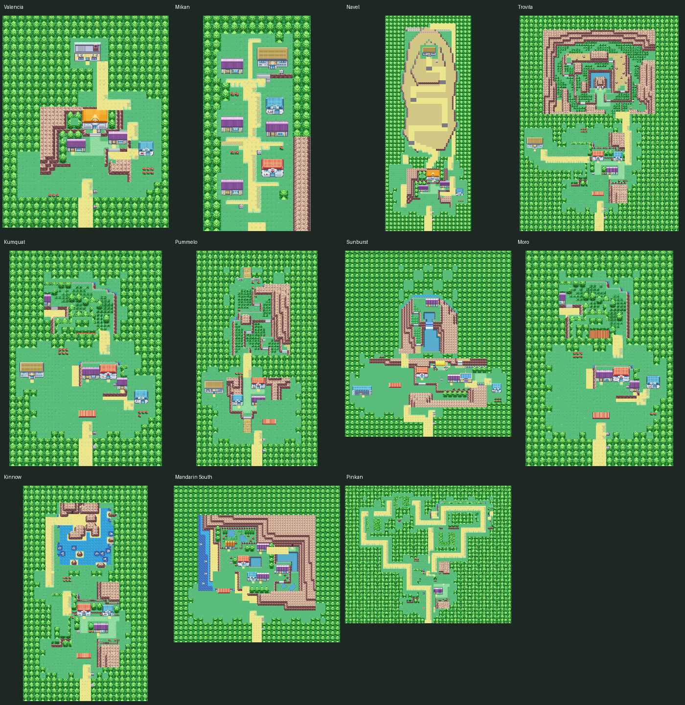

| Orange island | Town inspiration | Surrounding-route inspiration | Editable previews |
| --- | --- | --- | --- |
| Valencia | [One Island](sevii-reference-maps/OneIsland.png) | [One Island — TreasureBeach](sevii-reference-maps/OneIsland_TreasureBeach.png) | [Town](OrangeIslands_Valencia.png) · [Coast](OrangeIslands_Valencia_Beach.png) |
| Mikan | [Three Island](sevii-reference-maps/ThreeIsland.png) | [Three Island — Port](sevii-reference-maps/ThreeIsland_Port.png), [Three Island — BondBridge](sevii-reference-maps/ThreeIsland_BondBridge.png) | [Town](OrangeIslands_Mikan.png) · [Coast](OrangeIslands_Mikan_Beach.png) |
| Sunburst | [Two Island](sevii-reference-maps/TwoIsland.png) | [Two Island — CapeBrink](sevii-reference-maps/TwoIsland_CapeBrink.png) | [Town](OrangeIslands_Sunburst.png) · [Coast](OrangeIslands_Sunburst_Beach.png) |
| Navel | [One Island](sevii-reference-maps/OneIsland.png) | [One Island — KindleRoad](sevii-reference-maps/OneIsland_KindleRoad.png) | [Town](OrangeIslands_Navel.png) · [Coast](OrangeIslands_Navel_Beach.png) |
| Moro | [Five Island](sevii-reference-maps/FiveIsland.png) | [Five Island — Meadow](sevii-reference-maps/FiveIsland_Meadow.png), [Five Island — MemorialPillar](sevii-reference-maps/FiveIsland_MemorialPillar.png) | [Town](OrangeIslands_Moro.png) · [Coast](OrangeIslands_Moro_Beach.png) |
| Kinnow | [Six Island](sevii-reference-maps/SixIsland.png) | [Six Island — OutcastIsland](sevii-reference-maps/SixIsland_OutcastIsland.png), [Six Island — WaterPath](sevii-reference-maps/SixIsland_WaterPath.png) | [Town](OrangeIslands_Kinnow.png) · [Coast](OrangeIslands_Kinnow_Beach.png) |
| Mandarin South | [Four Island](sevii-reference-maps/FourIsland.png) | [Five Island — Meadow](sevii-reference-maps/FiveIsland_Meadow.png) | [Town](OrangeIslands_Mandarin_South.png) · [Coast](OrangeIslands_Mandarin_South_Beach.png) |
| Trovita | [Six Island](sevii-reference-maps/SixIsland.png) | [Six Island — RuinValley](sevii-reference-maps/SixIsland_RuinValley.png), [Six Island — GreenPath](sevii-reference-maps/SixIsland_GreenPath.png) | [Town](OrangeIslands_Trovita.png) · [Coast](OrangeIslands_Trovita_Beach.png) |
| Kumquat | [Five Island](sevii-reference-maps/FiveIsland.png) | [Five Island — Meadow](sevii-reference-maps/FiveIsland_Meadow.png), [Five Island — ResortGorgeous](sevii-reference-maps/FiveIsland_ResortGorgeous.png) | [Town](OrangeIslands_Kumquat.png) · [Coast](OrangeIslands_Kumquat_Beach.png) |
| Pinkan | [Six Island](sevii-reference-maps/SixIsland.png) | [Six Island — GreenPath](sevii-reference-maps/SixIsland_GreenPath.png) | [Town](OrangeIslands_Pinkan.png) · [Coast](OrangeIslands_Pinkan_Beach.png) |
| Pummelo | [Seven Island](sevii-reference-maps/SevenIsland.png) | [Seven Island — SevaultCanyon Entrance](sevii-reference-maps/SevenIsland_SevaultCanyon_Entrance.png), [Seven Island — TrainerTower](sevii-reference-maps/SevenIsland_TrainerTower.png) | [Town](OrangeIslands_Pummelo.png) · [Coast](OrangeIslands_Pummelo_Beach.png) |

The Orange maps adapt native layouts and scenery, with added districts, forecourts and connecting trails. Sea routes 1–14 retain their earlier geometry; their island connections now lead to the coastal maps. Towns connect to those coasts through dry land crossings. Existing map IDs are preserved, and the ten new coast IDs are appended.

## Valencia

Ivy village and research gardens. Town: 44×56; coast: 88×40.

 <a href="OrangeIslands_Valencia_Beach.png">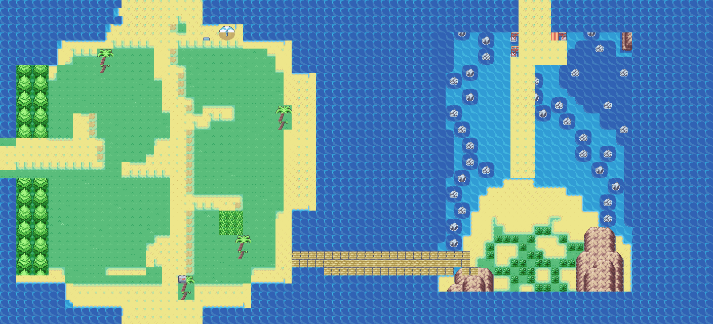</a>

## Mikan

Forest town and separate bridged harbor; approved previous revision. Town: 24×48; coast: 64×44.

 

## Sunburst

Cape terraces and glass workshop. Town: 68×76; coast: 134×36.

 <a href="OrangeIslands_Sunburst_Beach.png">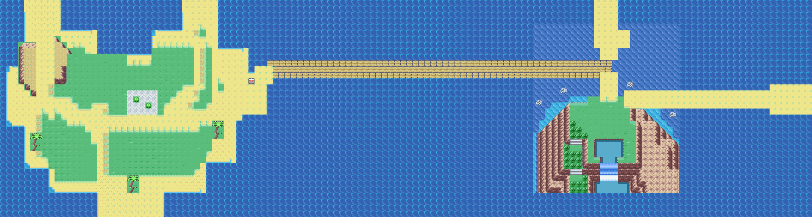</a>

## Navel

Mountain trail and summit Gym. Town: 44×110; coast: 98×60.

 <a href="OrangeIslands_Navel_Beach.png">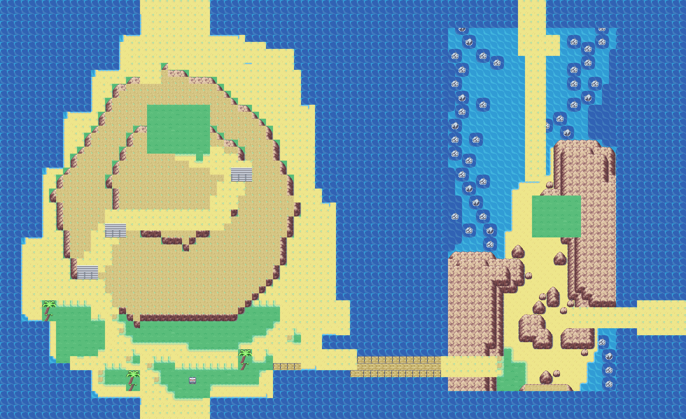</a>

## Moro

Forest hamlet and memorial headland. Town: 44×64; coast: 84×30.

 <a href="OrangeIslands_Moro_Beach.png">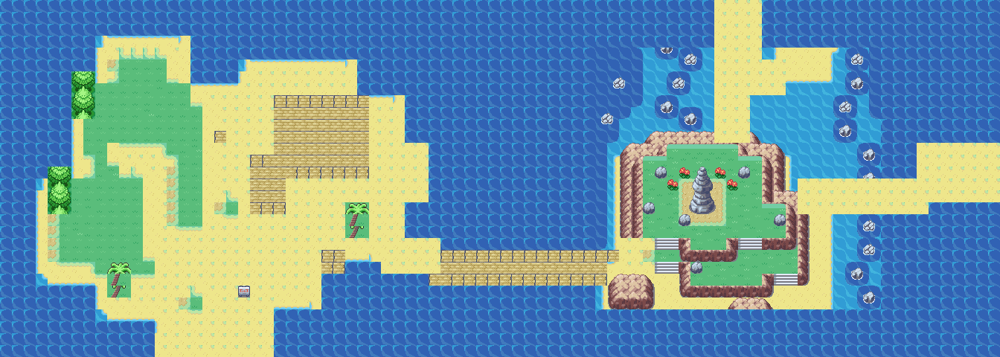</a>

## Kinnow

Harbor settlement and northern wilds. Town: 44×76; coast: 86×30.

 <a href="OrangeIslands_Kinnow_Beach.png">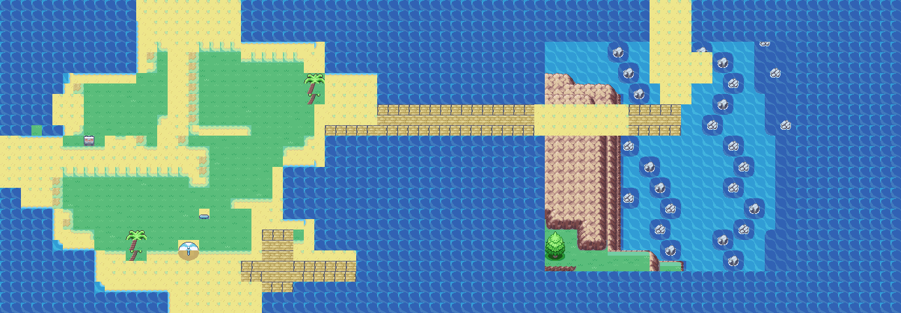</a>

## Mandarin South

Canal city and garden districts. Town: 68×64; coast: 132×50.

 <a href="OrangeIslands_Mandarin_South_Beach.png">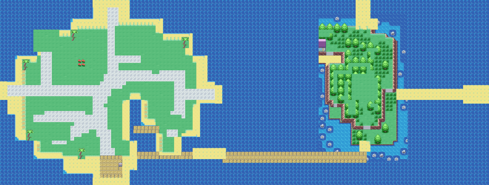</a>

## Trovita

Valley settlement and wooded Gym. Town: 68×92; coast: 124×40.

 <a href="OrangeIslands_Trovita_Beach.png">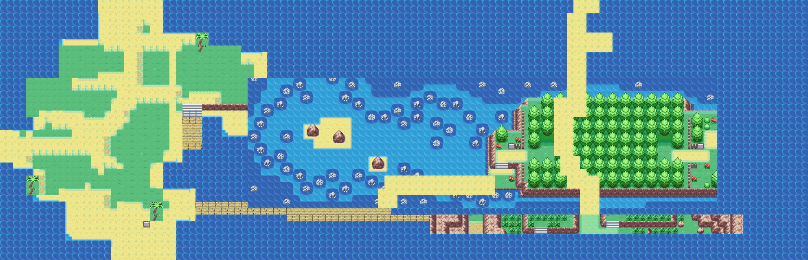</a>

## Kumquat

Resort village and waterside gardens. Town: 44×62; coast: 96×40.

 <a href="OrangeIslands_Kumquat_Beach.png">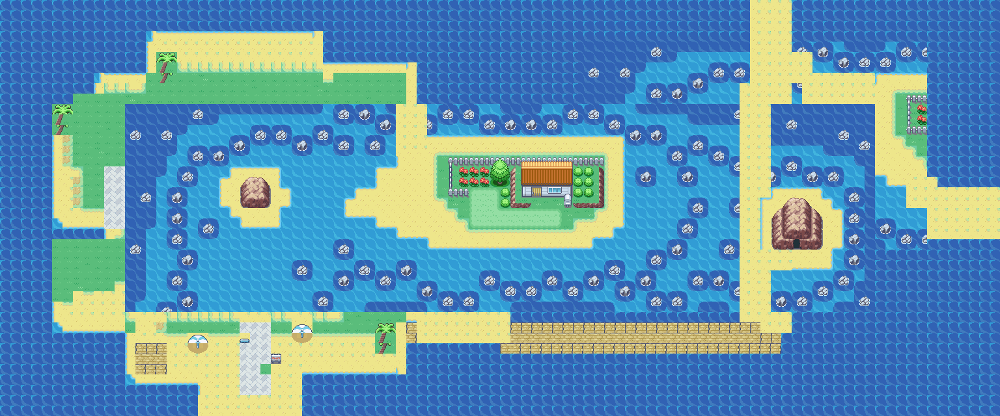</a>

## Pinkan

Forest reserve and research outpost. Town: 92×76; coast: 136×40.

 <a href="OrangeIslands_Pinkan_Beach.png">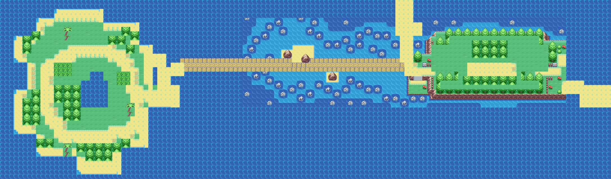</a>

## Pummelo

League town and canyon approach. Town: 44×78; coast: 88×40.

 <a href="OrangeIslands_Pummelo_Beach.png">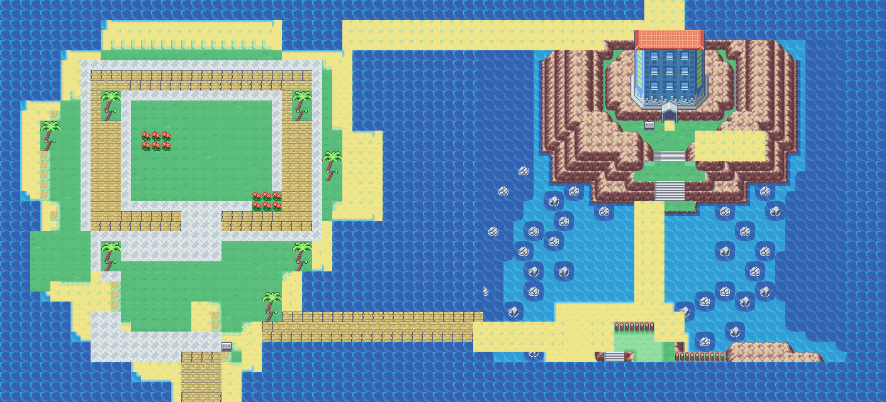</a>

## Tilesets and checks

Three added secondary sets combine the first 96 shared tropical metatiles with selected native Sevii assets. They use OrangeGeneral; originals remain intact.

| Secondary | Graphics occupied / 384 | Metatiles / 384 |
| --- | --- | --- |
| OrangeSevii123 | 338 | 357 |
| OrangeSevii45 | 258 | 241 |
| OrangeSevii67 | 295 | 275 |

`build_sevii_region_tilesets.py` checks packing and refuses to overwrite subsequent metatile, attribute or graphics edits. Palette edits are preserved. `render_maps.py` refreshes previews from the current source data, using static animation frames.

Validation covers all 36 registered exteriors: map buffers, metatile bounds, dry-path elevations, reachable landmarks and signs, current termination, reciprocal offsets, shared connection strips, matching walkable seams, and exact ROM layout data. The ROM builds successfully. Emulator traversal, Surf transitions, followers and event behavior still need a playtest.

Building and cave entrances remain blocked for later interiors. Ferries, NPCs, encounters and battle scripts are outside this exterior pass. Pummelo remains outside the sea-route network until its League ferry is added; its town and coast are connected to each other.
