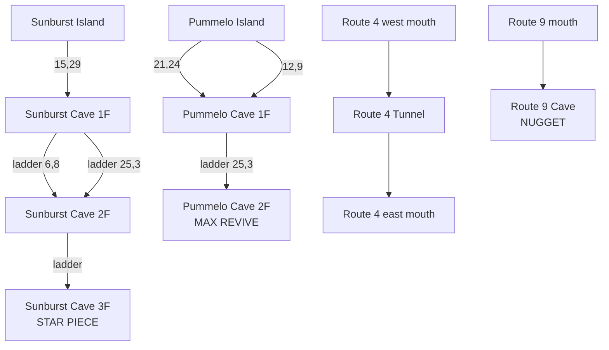

# Orange Islands caves

## What was there

| Map | State before |
| --- | --- |
| Sunburst Cave 1F | drawn, one island exit, two ladder tiles wired to nothing |
| Sunburst Cave 2F | **the ground floor copied** into a 46x35 canvas, 0 warps |
| Sunburst Cave 3F | blank 44x63 rectangle, 0 warps |
| Pummelo Cave 1F | drawn, two island mouths, one ladder tile wired to nothing |
| Pummelo Cave 2F | blank 20x20 — and present **twice**, as `OrangeIsland_Pummelo_Cave_2F` and `OrangeIslands_Pummelo_Cave2`, byte-identical |
| Route 4 | two cave mouths drawn, no warps, no cave |
| Route 9 | one cave mouth drawn, no warp, no cave |

## What it is now

Sunburst is three floors with **two** ladders between 1F and 2F, so the middle
floor is a loop rather than a corridor. Pummelo stays a through-cave between its
two island mouths and now has an upper floor hanging off it. Route 4's two mouths
are a genuine tunnel — in one side and out the other, shorter than walking the
route. Route 9's is a short dead end with something at the end of it.

## How the new floors were made

The two drawn ground floors are hand-made and **their blockdata is never touched**;
the generator only adds warps onto the ladder tiles that were already drawn on them.
Everything else is generated by `_follower_port_work/patches/orange_caves.py`:
rooms scattered on a grid, joined as a spanning tree plus a few extra edges so
each floor has loops, then the ladders placed in rooms and the whole floor
checked for connectivity before anything is written. It is seeded, so re-running
reproduces the same caves.

Generated floors are plainer than the hand-drawn ones — flat rock walls, no ponds
or ledges. They are meant as a playable skeleton to dress up in Porymap.

## Known leftover

`OrangeIsland_Pummelo_Cave_2F` (singular prefix) is the duplicate blank, and it is
filed under `gMapGroup_Orange_Sunburst_Interior` by mistake. It is left in place:
it is not last in that group, so deleting it would shift the map numbers of the
Sunburst Pokémon Center and break existing saves. Nothing references it.
