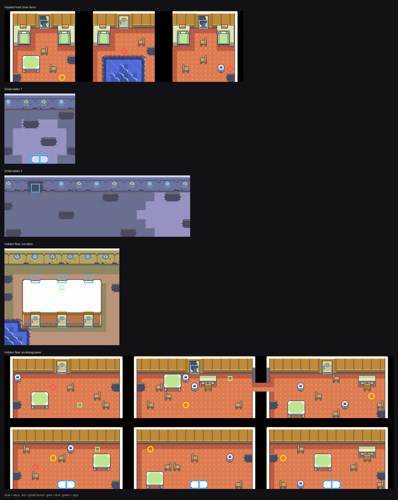
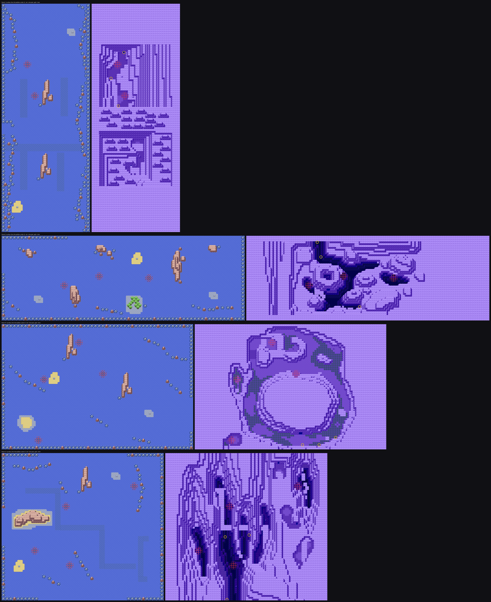

# Dive

HM08 and five places to use it: the ghost ship's flooded hold, and dive
pools on four of the sea routes.

## The move

Almost all of Dive was already in the engine and unreachable. `FldEff_UseDive`,
`MetatileBehavior_IsDiveable`, `IsUnableToEmerge`, `SetDiveWarpDive`,
`SetDiveWarpEmerge`, `DoDiveWarp`, `MAP_SCRIPT_ON_DIVE_WARP`,
`MAP_TYPE_UNDERWATER`, `PLAYER_AVATAR_FLAG_UNDERWATER`, the `setdivewarp`
script command, the `connection_dive` / `connection_emerge` macros, HM08
carrying the Dive description in the TM case, `MOVE_DIVE` already at the end
of `sHMMoves` and of the TM/HM move table, and 76 species with `TMHM(HM08_DIVE)`
in their learnsets — all present. What was missing was the party menu.

- `FIELD_MOVE_DIVE` is **12**, appended after `FIELD_MOVE_SWEET_SCENT`, not
  inserted. The badge check in `Task_HandleSelectionMenuInput` maps a field
  move index straight onto `FLAG_BADGE01_GET + index`, so inserting Dive
  anywhere before Waterfall would silently re-badge Teleport, Dig, Softboiled
  and Sweet Scent.
- Because it sits past that range it gets its own gate instead:
  **`FLAG_BADGE_CORAL_EYE`**, Cissy's badge. The first Orange gym is a water
  gym, and it means Dive is live for nearly the whole archipelago.
- `SetUpFieldMove_Dive` is the only field move that does not test a metatile
  itself. `TrySetDiveWarp` both answers "is there anywhere to go from here"
  and records where, so one call does both; it was `static` and dead, and is
  now exported.
- `gText_DiveUnderwater` and `gText_QuestLog_UsedDive` already existed in the
  repo, still carrying untranslated Japanese. They are now English rather
  than duplicated.

### Only deep water is diveable

Stock FireRed's `MetatileBehavior_IsDiveable` accepts `MB_FAST_WATER` and
`MB_DEEP_WATER`. The Orange routes use fast water for their currents — Route 1
alone has 292 such tiles — and on any map carrying a dive warp every one of
them would have become a dive spot. It is narrowed to `MB_DEEP_WATER`, which
nothing else in the region used, so a dive pool is now something painted
deliberately and nothing else.

## Where it goes

### The ghost ship's flooded hold



Captain Voss hands over HM08 when you beat him, and the hold he warns about
is two rooms away. Below it is Emerald's own route through to the ship's
hidden floor, ported whole:

```
flooded hold  --dive->  Underwater 2 (17,4)
Underwater 2  --warp->  Underwater 1
Underwater 1  --surface->  hidden floor corridors (0,10)
hidden floor  --dive->  Underwater 1, and back out the way you came
```

Underwater 2 is almost entirely `MB_UNDERWATER_BLOCKED_ABOVE`, so the only
way on is through, and surfacing in the one open patch puts you back in the
hold. That behaviour is spelled `MB_NO_SURFACING` in Emerald, which is why
the behaviour translation needed a synonym table (see `ghost-ship.md`) before
any of this worked at all.

The hidden floor is six strongrooms with five items and two of the crew.
Emerald locks four of the six behind a chained key hunt — the key to room 1
is in room 3, room 1 holds the key to room 4, and so on — and those keys are
four items FireRed does not have. For now the doors are simply open. The
locking mechanism itself survives the port intact: the locked metatile
carries `MB_NORMAL` and the unlocked one `MB_WARP_DOOR`, and it is the
behaviour, not the collision, that decides whether the warp underneath ever
fires. Adding four key items would restore the whole puzzle.

### Four sea routes



| route | size | pools | seafloor | reachable |
|---|---|---|---|---|
| Route 5 | 48×124 | 2 | Underwater Route 105 | 114 / 146 cells |
| Route 8 | 132×46 | 3 | Underwater Route 128 | 470 / 480 |
| Route 10 | 104×68 | 4 | Underwater Route 126 | 1331 / 1332 |
| Route 13 | 88×80 | 4 | Underwater Route 127 | 730 / 990 |

Each pool is drawn exactly as Emerald draws one: `0x14F` in the middle,
`0x14E` blending out, corners left as the ocean that was already there. Both
ids are `hoenn_general`'s, which is a verbatim copy of Emerald's `general`,
so they carry over unchanged.

#### Why connections and not fixed dive warps

The ghost ship uses `setdivewarp`, which names one destination for a whole
map: one way down, one place to come up. That is wrong for a route, because
Emerald's underwater routes are not open water. Underwater Route 105 is
swimmable on 221 of its 3200 cells and the rest is rock, and the swimmable
part is several separate channels, each reached from its own pool on the
surface. Ported under a single fixed warp, most of a seafloor is water you
can see the edge of and never reach — 46% of Route 105's and 33% of Route
127's, measured before this was changed.

So these use `dive` / `emerge` connections, which carry the player's x,y
straight through. That makes the two maps share a coordinate space, so each
underwater map is cut to its route's own dimensions: a Hoenn seafloor pasted
in, the rest filled with rock.

Two things then have to be true, and `validate_dive.py` checks both rather
than trusting them:

1. **every swimmable underwater cell lies under open ocean.** Surfacing hands
   the player their current x,y on the route, and a swimmable cell under a
   cliff would leave them standing on land in surf state. The seafloor is
   masked against the route's own water, which also has the pleasant effect
   of shaping it to the islands above.
2. **every cell of a dive pool is swimmable directly below.** Diving hands the
   player their current x,y underwater, so a pool over rock would drop them
   inside it. The twelve cells under each pool are carved open — 8 to 19 per
   route.

```sh
python3 -B docs/orange-islands/validate_dive.py
```

It also confirms no `MB_FAST_WATER` survives on a route with a dive
connection, that every pool reaches the seafloor's open water, that the items
are reachable, and that each `dive` has a matching `emerge`.

### Encounters

Chinchou, Lanturn, Clamperl, Relicanth, Corsola, Staryu, Shellder, Horsea,
Seadra, Tentacool/Tentacruel and Cloyster, 26–37, varying by route.

They needed the same fix the ghost ship's floors did, for the same reason:
FireRed drives wild encounters off a 3-bit encounter-type field in the 4-byte
metatile attribute word, and Emerald's 2-byte word has no such field at all,
so every metatile of the ported seafloor arrived at `TILE_ENCOUNTER_NONE`.
162 of them are now `TILE_ENCOUNTER_LAND`.

### A correction to the seafloor tileset

`gTileset_HoennUnderwater` was ported into this repo before the behaviour
synonym table existed, and 35 of its metatiles came across as
`MB_DEEP_WATER` where Emerald has `MB_NO_SURFACING`. That is wrong twice
over: the player could surface anywhere underwater, and with
`MetatileBehavior_IsDiveable` narrowed to deep water those 35 would read as
dive spots while already underwater. They are re-derived from Emerald through
the tileset's own recorded `metatile_mapping`, with zero conflicts. Nothing
used the tileset before this.
