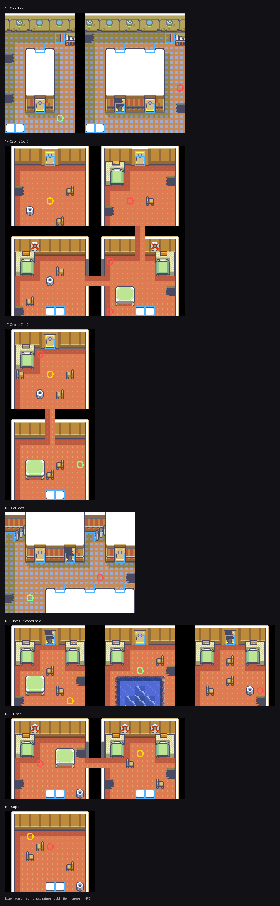

# The Moro ghost ship

Seven floors of derelict liner moored off Moro Island, ported from
pokeemerald's Abandoned Ship and re-crewed.



*blue = warp, red = ghost trainer, gold = item, green = NPC*

## What was ported, and what had to change

The tileset and all seven room layouts are pokeemerald's own, byte-for-byte,
with three mechanical translations applied. Each one would have shipped a
broken map if it had been missed, and only the first is the obvious one:

| | Emerald | FireRed | what needs shifting |
|---|---|---|---|
| `NUM_METATILES_IN_PRIMARY` | 512 | 640 | every metatile id in `map.bin`, `+128` |
| `NUM_TILES_IN_PRIMARY` | 512 | 640 | every tile index **inside `metatiles.bin`**, `+128` |
| `NUM_PALS_IN_PRIMARY` | 6 | 7 | palette 6 is secondary in Emerald and primary in FireRed |

The second one is easy to miss because the map still loads: it just draws
the wrong tiles, and it is wrong in the ROM as well as in any renderer.
1562 of the tileset's 2016 tile references moved.

The third is easy to miss because it only costs you 255 tile references out
of 2016 — barrels, stools and door panels, which came out blank. FireRed's
free secondary palette slot is 12, and the repo's existing
`hoenn_native_inside_ship` port moves Emerald's palette 6 there too, so this
port matches it rather than inventing a different scheme.

Metatile *behaviours* are translated by constant name, not by number
(`emerald_port.py`), because Emerald's are an `enum` and FireRed's are
`#define`s and the two orders disagree almost everywhere.

The tileset is `gTileset_AbandonedShip`, used by the ghost ship and nothing
else, so everything above is contained to the Orange Islands.

## Layout

Emerald's warp graph is kept exactly, warp indices included, so the two
halves of every door line up by construction rather than by re-derivation.
The only edit is at the top: Emerald's two deck stairways both put you back
out onto Moro.

```
                         MORO (32,51 dock)
                               |
    1F Corridors  --- 1F Cabins (port)   4 cabins
         |        --- 1F Cabins (fore)   2 cabins
         |
    B1F Corridors --- B1F Stores         3 rooms, middle one flooded
                  --- B1F Purser         2 rooms
                  --- B1F Captain        VOSS
```

Coming ashore lands on Moro warp 2 at (32,52), the water square south of the
boarding trigger. Landing on the trigger itself would re-board you forever.

## The crew

Nine ghost trainers, levels 23–30, drawing from two new pools
(`sPool_Channeler_Basic` / `_Intermediate`) except Captain Voss, who has a
handwritten team. Read in the order you meet them, their post-battle lines
tell the ship's story: she sailed from Moro, took on something the captain
struck off the manifest, and the hold flooded first.

| floor | trainer | level |
|---|---|---|
| 1F Corridors | CHANNELER MARISOL | 23 |
| 1F Cabins (port) | CHANNELER ODETTE | 23 |
| 1F Cabins (port) | CHANNELER THALIA | 24 |
| 1F Cabins (port) | SAILOR GRIFF | 24 |
| 1F Cabins (fore) | CHANNELER WREN | 24 |
| B1F Corridors | SAILOR MOSS | 25 |
| B1F Purser | CHANNELER ISOLDE | 25 |
| B1F Stores | SAILOR DUNCAN | 26 |
| B1F Captain | CAPTAIN VOSS | 27–30 |

## Items

Super Repel, Revive, Escape Rope, Big Pearl, and TM30 (Shadow Ball) in the
captain's room behind Voss.

## Wild encounters

Gastly / Haunter / Shuppet / Duskull / Misdreavus / Zubat / Golbat, 22–28,
at a low rate (8) so they stay atmospheric.

These work because the ship tileset's floor metatiles carry
`MB_INDOOR_ENCOUNTER` — Emerald's own choice, carried over by the behaviour
translation. What the port could *not* carry over is the encounter type:
FireRed's metatile attribute word has a 3-bit encounter-type field at bits
24–26 and Emerald's 2-byte word has no such field at all, so every ported
metatile arrived at `TILE_ENCOUNTER_NONE`. 109 floor metatiles were set to
`TILE_ENCOUNTER_LAND`, in the secondary tileset only.

The flooded middle store room on B1F is the exception: its water comes from
`hoenn_general`, which other maps share, and those metatiles already carry
`TILE_ENCOUNTER_WATER`. They were left alone, and the room has its own water
table (Tentacool / Horsea / Shellder).

## Left for Dive

That flooded room is the hook. Voss and the NPC beside the pool both point
at it, and pokeemerald has `AbandonedShip_Underwater1` (8×8) and
`Underwater2` (21×7) sitting ready to port the same way.
