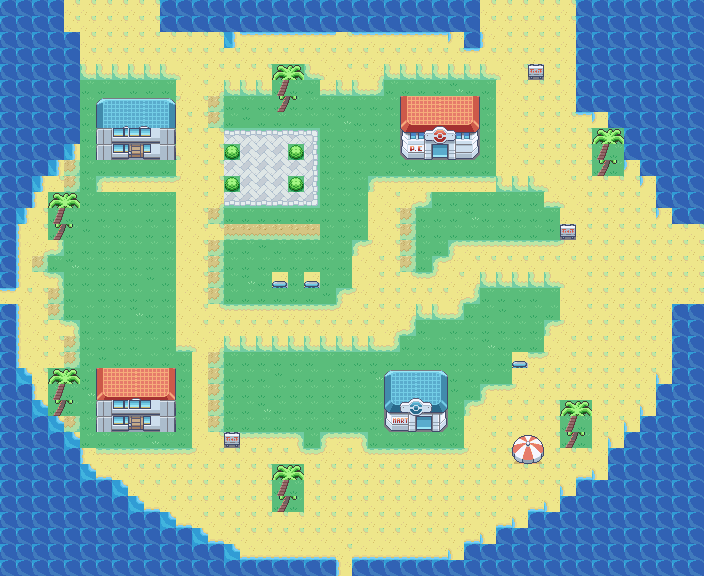
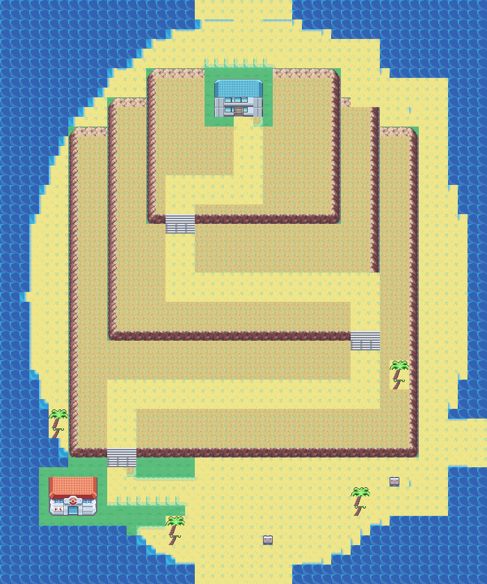
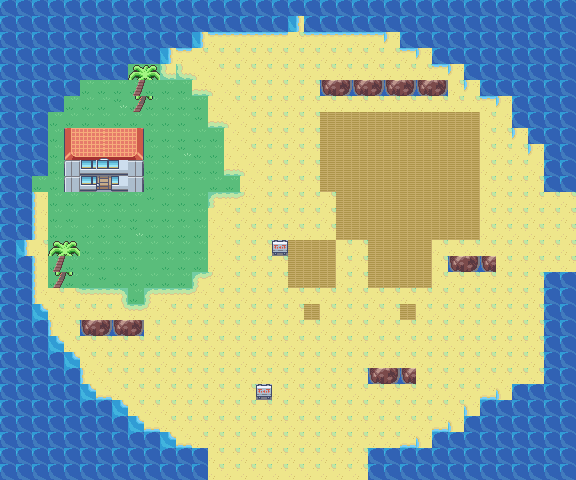
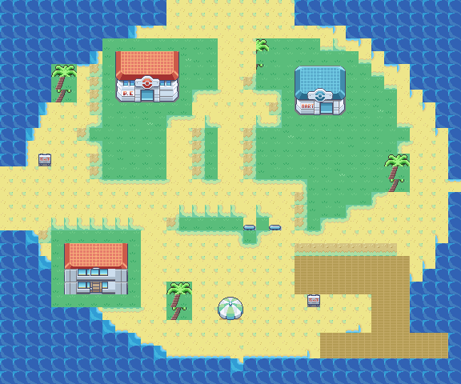
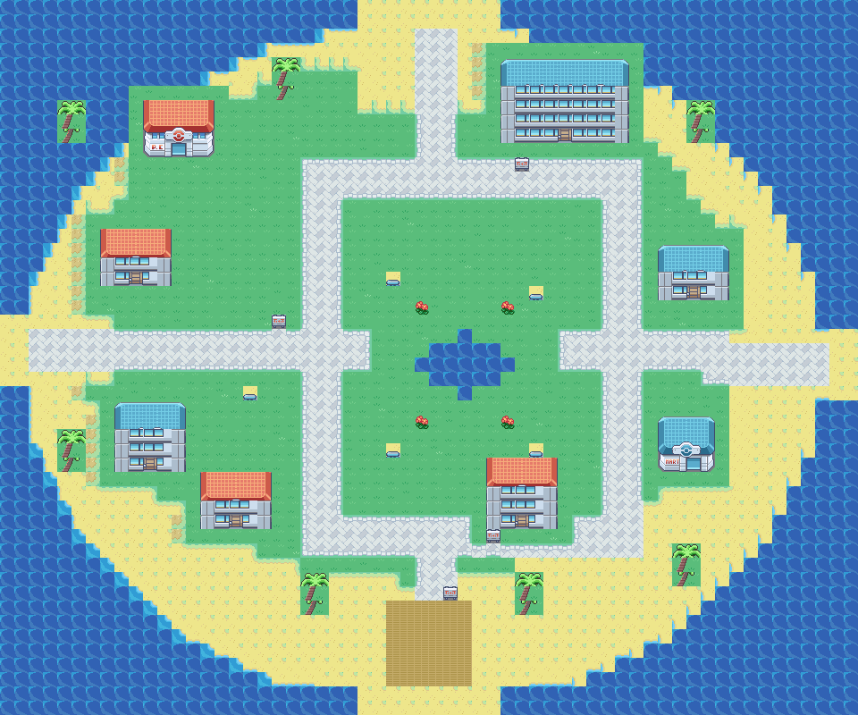
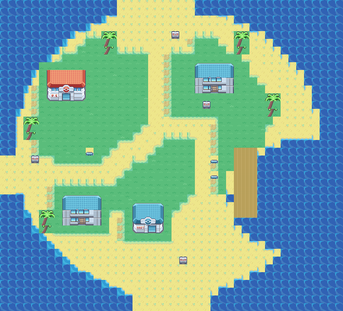
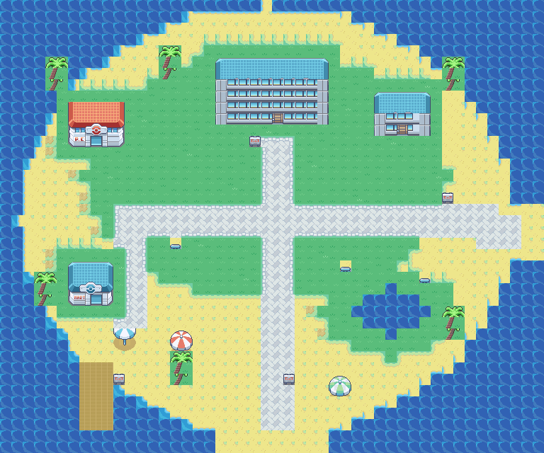
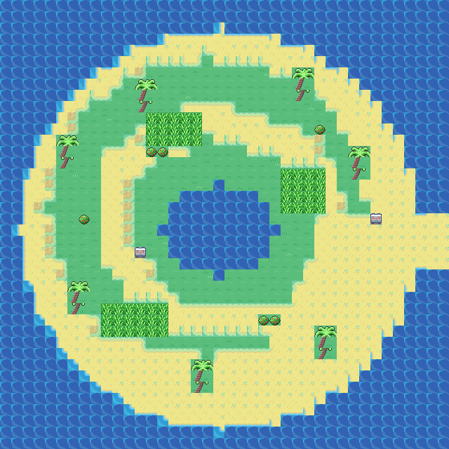
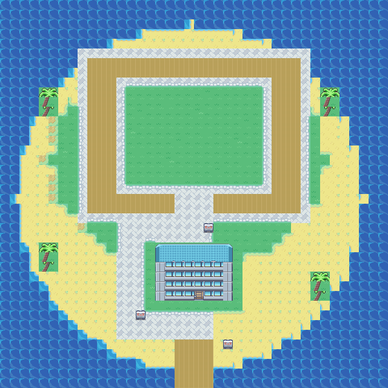

# Remaining island geography revisions

These ten revisions use Sevii geography and settlement structure as references. Mikan was revised earlier. Route connections and offsets remain unchanged; each island now has its own coastline and terrain structure. Interiors and story events remain pending.

| Island | New structure |
| --- | --- |
| [Valencia](../OrangeIslands_Valencia.png) | Forest-backed village following the user reference, with Ivy lab on the north shore and a stepped east beach. |
| [Sunburst](../OrangeIslands_Sunburst.png) | Twin north coves and a cliff-backed workshop village; east landing and a separate southern residential shelf. |
| [Navel](../OrangeIslands_Navel.png) | Tapered mountain island with two irregular cliff terraces, a coastal bypass, and a southwest foothill settlement. |
| [Moro](../OrangeIslands_Moro.png) | Narrow forest spit with an eastern wreck cove and a beached timber site, approached from two different shores. |
| [Kinnow](../OrangeIslands_Kinnow.png) | Elongated north-shore village ending at a south-facing performance harbor and outer showboat berth. |
| [Mandarin_South](../OrangeIslands_Mandarin_South.png) | Four urban districts wrapping a deep inlet, with a waterfront store, tutor quarter, pocket gardens and southern harbor. |
| [Trovita](../OrangeIslands_Trovita.png) | Hook-shaped bay town, with a western village, narrow southern beach and eastern Gym bluff overlooking the water. |
| [Kumquat](../OrangeIslands_Kumquat.png) | Resort ribbon wrapping a quiet western cove, with separate Gym gardens, hotel promenade and southern ferry pier. |
| [Pinkan](../OrangeIslands_Pinkan.png) | Jagged wooded reserve with two forest lobes, an interior wetland and a loop trail from the east landing. |
| [Pummelo](../OrangeIslands_Pummelo.png) | Stadium peninsula with a narrow boat approach, stepped spectator grounds and a separate reception lane. |

## Valencia

Forest-backed village following the user reference, with Ivy lab on the north shore and a stepped east beach.

### Before

### After

## Sunburst

Twin north coves and a cliff-backed workshop village; east landing and a separate southern residential shelf.

### Before

### After

## Navel

Tapered mountain island with two irregular cliff terraces, a coastal bypass, and a southwest foothill settlement.

### Before

### After

## Moro

Narrow forest spit with an eastern wreck cove and a beached timber site, approached from two different shores.

### Before

### After

## Kinnow

Elongated north-shore village ending at a south-facing performance harbor and outer showboat berth.

### Before

### After

## Mandarin_South

Four urban districts wrapping a deep inlet, with a waterfront store, tutor quarter, pocket gardens and southern harbor.

### Before

### After

## Trovita

Hook-shaped bay town, with a western village, narrow southern beach and eastern Gym bluff overlooking the water.

### Before

### After

## Kumquat

Resort ribbon wrapping a quiet western cove, with separate Gym gardens, hotel promenade and southern ferry pier.

### Before

### After

## Pinkan

Jagged wooded reserve with two forest lobes, an interior wetland and a loop trail from the east landing.

### Before

### After

## Pummelo

Stadium peninsula with a narrow boat approach, stepped spectator grounds and a separate reception lane.

### Before

### After

