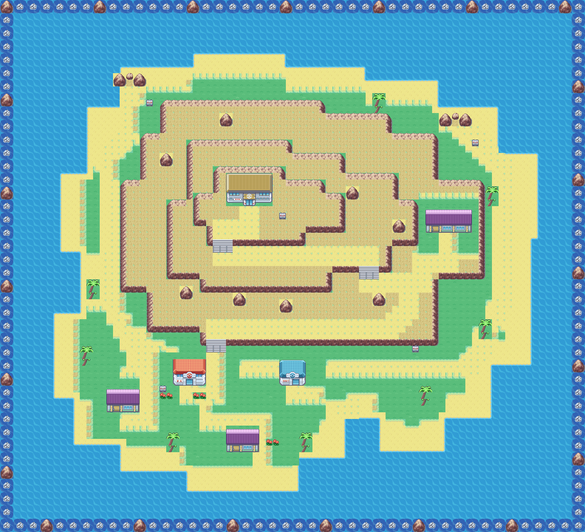
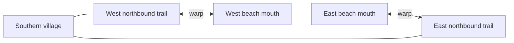

# Navel Island — mountain village and north-coast loop

This exterior draft follows the supplied sketch: a sandy rim around a large island, a southern village, a long switchback ascent, a summit building and a separate building on the eastern shoulder. Two northbound trail mouths lead to opposite ends of a **separate beach map**. All previews render the actual Porymap blocks and tilesets.

As confirmed in the sketch, the brown summit building is Danny's Gym and the eastern purple building is a larger home. The home has an additional complete window bay and a wider roof than the two southern houses. The red/blue services and smaller homes sit below the mountain. Interiors remain for later.

| Map | Size | Tilesets |
| --- | --- | --- |
| Navel | 88 × 80 | OrangeGeneral + OrangeSevii123 |
| Navel Beach | 88 × 38 | OrangeGeneral + OrangeSevii123 |

## Island and village



Water surrounds the island. A wide sand margin, stepped headlands, a southern inlet and sparse palms replace the forest enclosure. Three cliff faces and stair openings guide the winding ascent. The Center, Mart and homes cluster in the southern lowland; the eastern shoulder has its own building approach.

## Separate north beach


The dry shore path links the western and eastern trail mouths, passing three coves and cliff-backed stretches. Walking north from either town mouth enters this map; walking south from a beach mouth returns to the corresponding side of town. Either direction completes the loop without Surf.



| Town warp | Town position | Beach position | Beach warp |
| --- | --- | --- | --- |
| 0 | 19, 12 | 19, 30 | 0 |
| 1 | 68, 18 | 74, 30 | 1 |

These are directional arrow warps with native sand graphics and boulder-flanked mouths. Hold north on a town mouth or south on a beach mouth. FireRed turns arrivals toward the open trail, away from the return direction. Signposts mark both paths. The existing external map connections are unchanged; other island links remain for the user to arrange.

## Before this pass

[Old forest-backed town](before-town.png) · [Old coast layout](before-beach.png)

## Validation and editing

Open `OrangeIslands_Navel` and `OrangeIslands_Navel_Beach` in Porymap. The tracked binaries are the maps, not just preview images. Native Sevii house metatiles are translated through the existing packing table; land boulders use the complete native Kindle Road motif. No tileset artwork, palettes or original Sevii maps were changed.

```sh
python3 -B docs/orange-islands/navel/validate_navel.py
source /workspace/.setup-cache/activate.sh
make -j5 -W data/maps.s
python3 -B docs/orange-islands/navel/validate_navel.py --rom
```

The focused check verifies map-buffer limits, IDs, land/water elevations, sealed edges, connected dry terrain, three required stair crossings, every building/sign approach, configured directional warp tiles, reciprocal destinations, safe arrival steps and exact ROM map blocks. The ROM builds successfully. Emulator traversal, follower movement and warp transitions still need playtesting.

`build_navel.py` recreates this authored draft and **overwrites later Porymap edits to these two maps**. It is optional and is not part of the ROM build. `landmarks.json` records the draft's approaches and facade footprints.
