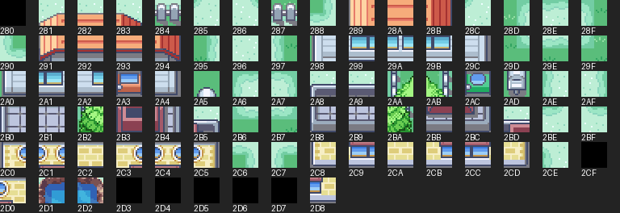
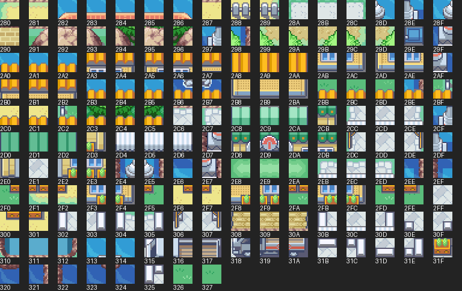
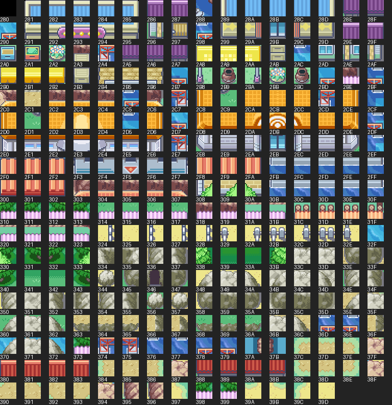
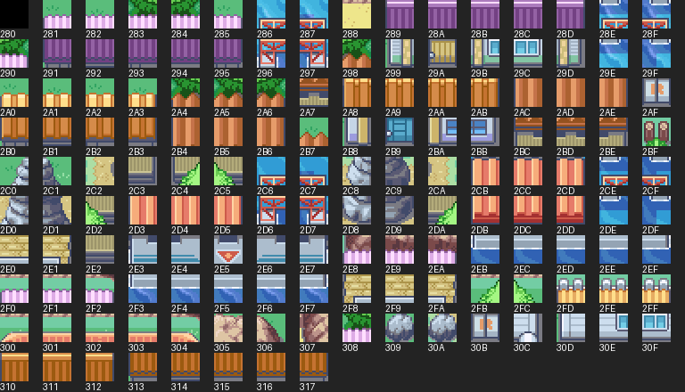
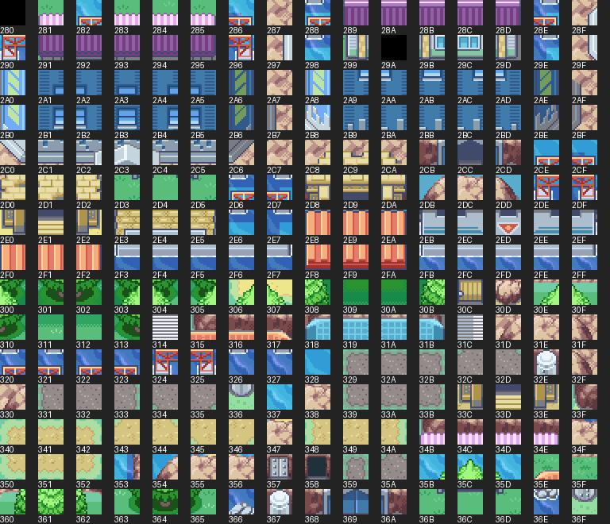

# Condensed town and city secondary tilesets

Five independent copies are registered for Porymap and the ROM build. No existing map assignments or original tilesets were changed. Pair these copies with **gTileset_OrangeGeneral**, not the original General, because their primary graphic references have been remapped.

| Tileset | Source PNG slots | Referenced source slots | Condensed occupied slots | Free of 384 |
| --- | ---: | ---: | ---: | ---: |
| pallet_town | 80 | 63 | 63 | 321 |
| vermilion_city | 144 | 114 | 101 | 283 |
| sevii_islands_123 | 384 | 215 | 176 | 208 |
| sevii_islands_45 | 384 | 158 | 146 | 238 |
| sevii_islands_67 | 384 | 270 | 211 | 173 |

Source PNG counts include padding. Savings combine unused-graphics removal and exact/flip duplicate packing; they are not all mirrored duplicates. Condensed PNGs include up to 15 blank tiles for rectangular image alignment. Free bank capacity is 384 minus occupied tiles. No palette colors or metatile attributes were edited in these copies; the paired Orange General still supplies its own grass/water/building colors.

All five source sets use NULL animation callbacks. Their primary water/flower animations come from Orange General. Other animated tilesets need special handling and must not be fed into this static packer.

In Porymap, select OrangeGeneral as primary and one of the following as secondary on a new or deliberately converted map. Replacing OrangeIslands secondary on an existing map will change the meaning of its secondary metatile IDs; rebuild/remap those map blocks first. These copies preserve their own source IDs, not OrangeIslands IDs.

| Source | New secondary symbol |
| --- | --- |
| pallet_town | `gTileset_PalletTownCondensed` |
| vermilion_city | `gTileset_VermilionCityCondensed` |
| sevii_islands_123 | `gTileset_SeviiIslands123Condensed` |
| sevii_islands_45 | `gTileset_SeviiIslands45Condensed` |
| sevii_islands_67 | `gTileset_SeviiIslands67Condensed` |

Regenerate and validate with `python3 docs/orange-islands/condense_secondary_tilesets.py`. It checks all 935 metatiles, flip orientation, palette-bank references, attribute preservation and PNG/4bpp round trips. Existing independently edited metatiles are protected; edited palettes are retained. Build with the normal repository make command. In-game use still needs testing after map integration.

## pallet_town

## vermilion_city

## sevii_islands_123

## sevii_islands_45

## sevii_islands_67

