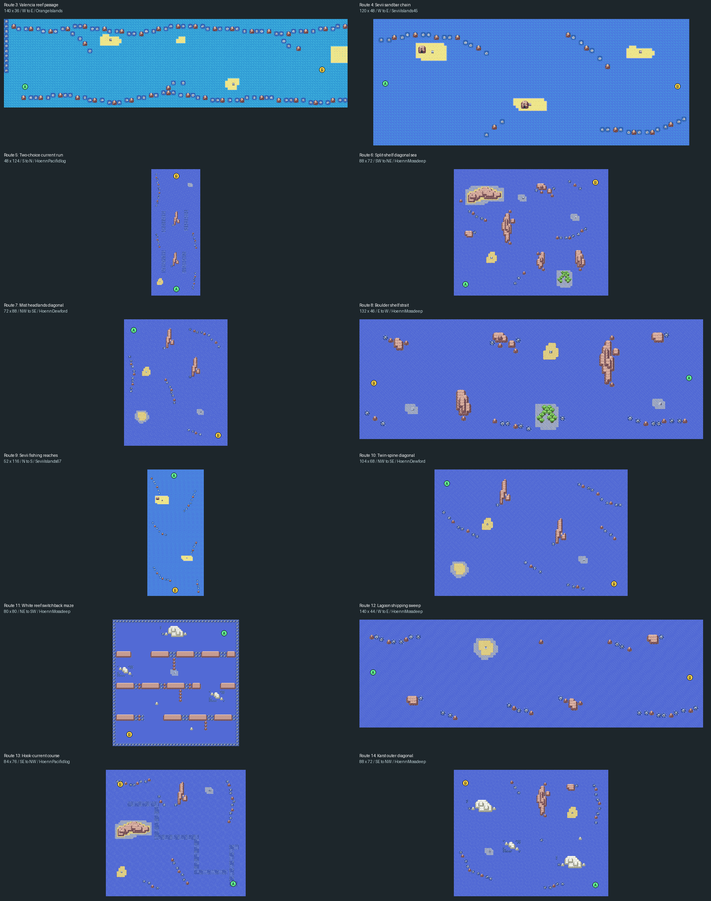
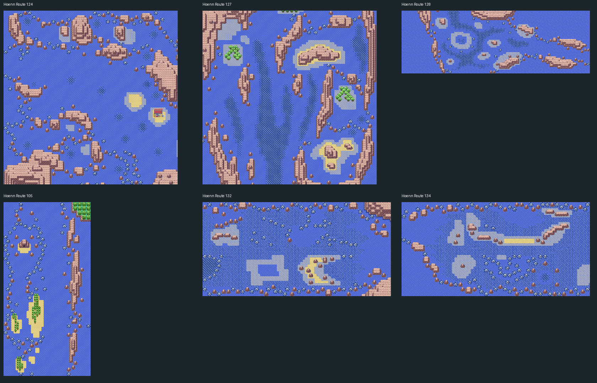

# Orange sea routes — tilesets, directions and puzzles

Eleven sea routes have been rebuilt with **six tileset pairings**, wider map shapes and varied crossing directions. Route 3 retains its existing Valencia/Mikan beach seams and layout. All connection records are preserved; the other island links remain for the user to arrange.

The maps now mix native FireRed/Sevii scenery with **Hoenn General + Mossdeep, Dewford and Pacifidlog**. Hoenn cliff shelves, white karst formations, wet shoals, forested islets and currents give the routes different landmarks. Walkable land remains under 5% per map; larger rock formations are collision barriers rather than large traversable islands.



**A** marks the intended entrance and **B** the intended exit. These are navigation anchors in this overview, not newly created connections. Diagonal labels describe travel within the map; engine connections still use cardinal map edges. Individual previews below have no marker overlays.

| Route | Size | Crossing | Tilesets | Preview |
| --- | --- | --- | --- | --- |
| 3 — Valencia reef passage | 140 × 36 | W → E | OrangeGeneral + OrangeIslands | [View](../OrangeIslands_Route_3.png) |
| 4 — Sevii sandbar chain | 120 × 48 | W → E | General + SeviiIslands45 | [View](../OrangeIslands_Route_4.png) |
| 5 — Two-choice current run | 48 × 124 | S → N | HoennGeneral + HoennPacifidlog | [View](../OrangeIslands_Route_5.png) |
| 6 — Split-shelf diagonal sea | 88 × 72 | SW → NE | HoennGeneral + HoennMossdeep | [View](../OrangeIslands_Route_6.png) |
| 7 — Mist headlands diagonal | 72 × 88 | NW → SE | HoennGeneral + HoennDewford | [View](../OrangeIslands_Route_7.png) |
| 8 — Boulder shelf strait | 132 × 46 | E → W | HoennGeneral + HoennMossdeep | [View](../OrangeIslands_Route_8.png) |
| 9 — Sevii fishing reaches | 52 × 116 | N → S | General + SeviiIslands67 | [View](../OrangeIslands_Route_9.png) |
| 10 — Twin-spine diagonal | 104 × 68 | NW → SE | HoennGeneral + HoennDewford | [View](../OrangeIslands_Route_10.png) |
| 11 — White reef switchback maze | 80 × 80 | NE → SW | HoennGeneral + HoennMossdeep | [View](../OrangeIslands_Route_11.png) |
| 12 — Lagoon shipping sweep | 140 × 44 | W → E | HoennGeneral + HoennMossdeep | [View](../OrangeIslands_Route_12.png) |
| 13 — Hook-current course | 84 × 76 | SE → NW | HoennGeneral + HoennPacifidlog | [View](../OrangeIslands_Route_13.png) |
| 14 — Karst outer diagonal | 88 × 72 | SE → NW | HoennGeneral + HoennMossdeep | [View](../OrangeIslands_Route_14.png) |

## Current and maze prototypes

**Route 5 — two-choice current run.** Two sets of current lanes flank cliff spines. The lower right lane carries the player north; the lower left lane returns south. The upper pair reverses the useful side. Read the visible current direction to choose a lane. Calm water provides a bypass on either side.

**Route 13 — hook-current course.** A westward/northward current turns through several elbows toward the northwest. The outer U-shaped current returns the player to calm water near the southeast starting area. Each elbow carries all lanes through the turn. This course is optional; open water remains available around it.

**Route 11 — reef switchback maze.** Three boulder/cliff barriers have alternating gaps, with short dead-end fingers between them. The northeast-to-southwest crossing takes at least **190 steps**. Closing any one of the three gates makes the exit unreachable, so swimming around the outside cannot skip the puzzle. Every branch has a route back.

These use existing FireRed Surf and forced-current behavior. Emulator playtesting is still needed to assess movement, follower behavior, timing and difficulty. Trainers and rewards can be placed after the layout review.

## Connections and preserved work

Every connection direction, offset and destination is unchanged. Valencia town/beach, Mikan Beach, Route 3 and all tileset assets are unchanged in this pass. Routes 1–2 and the original Sevii maps are also untouched. The earlier Mikan Beach water-elevation correction remains in place.

**When arranging the remaining links:** direct scrolling connections need compatible primary tilesets and shared metatile definitions/palettes in their visible border strips. A Hoenn route cannot simply share an edge with an OrangeGeneral beach. Use a matching beach/transition tileset and compatible border strips, or a ferry/warp transition. The current Route 3 chain retains its compatible Orange pairing.

## Native references and shore finishing

The supplied Routes **124, 127 and 128** were inspected using the equivalent native layouts in the pinned `pret/pokeemerald` reference checkout (`731ad5bfd6e6f265508d0efcca0ba42f9dcf5881`). Their broad basins, long cliff spines, offset shelves and branching channels informed the new layouts. Routes 105, 126, 132–134 supplied additional reef, karst and current references.



Complete small terrain motifs were translated using the existing Hoenn import mappings, then relocated into new compositions. Cropped wet shores were completed from native 3×3 terrain-mask frequencies and directional tile-pair counts; incidental fragments from neighboring source features were removed. The source coordinates, adjusted motifs and measured grammar are recorded here:

- [Hoenn motifs and provenance](hoenn-motifs.json)
- [Native Hoenn shore grammar](native-hoenn-shore-grammar.json)
- [FireRed beach motifs](native-beaches.json)
- [Authored placements and navigation anchors](designs.json)
- [Current route measurements and puzzle outcomes](metrics.json)

Local tile checks keep shore pieces coherent. The placement recipes define the larger landforms, channels and puzzle structure separately.

## Build and verification

```sh
python3 -B docs/orange-islands/water-routes/validate_routes.py
source /workspace/.setup-cache/activate.sh
make -j5 -W data/maps.s
python3 -B docs/orange-islands/water-routes/validate_routes.py --rom
```

The focused validator checks engine map-buffer limits, metatile IDs, elevations, native shore joins, complete reef objects, reachable land/signs and routes back to the exit. It follows every forced-current tile, checks every entry lane reaches the intended calm exit, verifies required maze gates, and checks a five-tile-wide calm crossing/bypass. The ROM check compares the exact current route binaries and connected beach binaries against the built ROM.

Hoenn asset validation checks imported artwork, loaded palettes, layers and animation banks. OrangeGeneral validation retains its asset checks and now accepts the explicit alternate route pairings. The older whole-region `validate_maps.py` still needs updating for the user's latest town tilesets and landmarks; its historical all-region result does not cover these newer town edits.

For Porymap edits, refresh images with `render_maps.py`. The optional `water-routes/build_routes.py` recreates Routes 4–14 from the tracked motifs/recipes and retains Route 3; **running it replaces subsequent Porymap edits to Routes 4–14**. It is not needed to compile the ROM. Existing connection records are retained when rebuilding.
